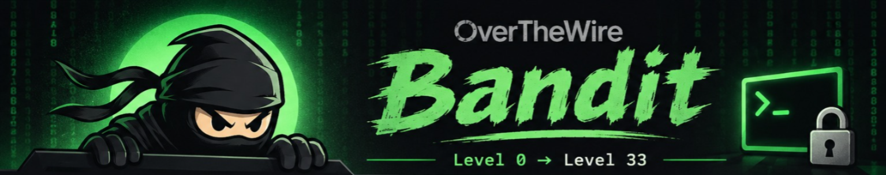

# Joo's Bandit Journey



## About

Bandit is a wargame designed to help beginners learn and practice essential Linux and cybersecurity skills through a series of increasingly challenging levels.

This repository contains my solutions, commands, and explanations for each level, documented throughout my learning journey.

## Repository Structure

```text
joo-beat-bandit/
├── assets/       # Repository images
├── levels/       # Level-by-level writeups
├── LICENSE
└── README.md
```

## Progress

|    Level     |  Status   |
| :----------: | :-------: |
| Level 0 – 33 | Completed |

## Disclaimer

This repository is intended for educational purposes only. It contains writeups and solutions for the OverTheWire Bandit wargame. No passwords, private keys, or other sensitive credentials are included.

## Acknowledgments

- [OverTheWire](https://overthewire.org/wargames/bandit/) — For providing the Bandit wargame.
